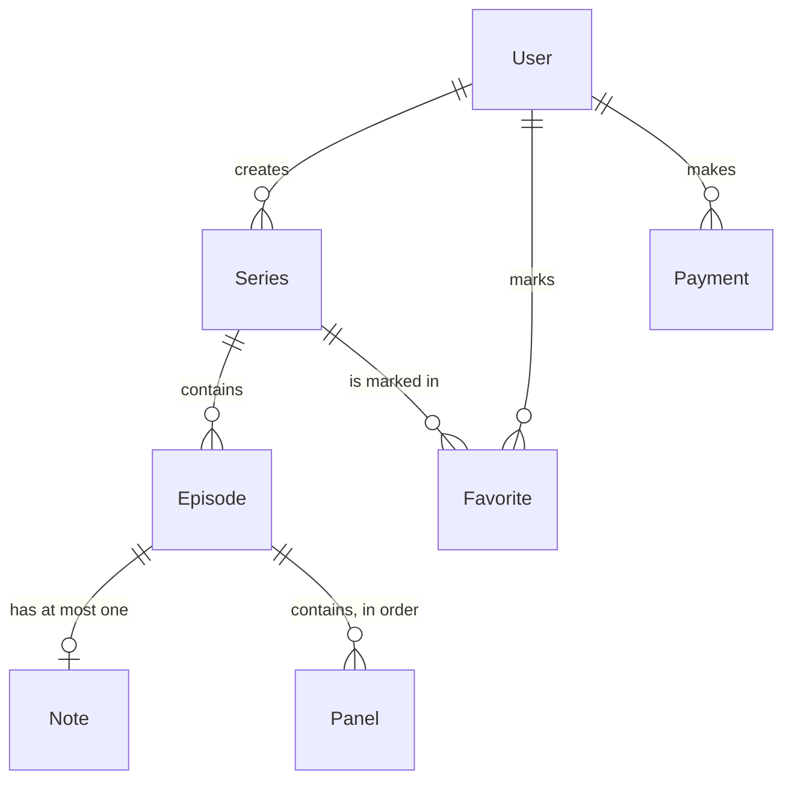

# Toonverse data model

Every MongoDB collection, described before any Mongoose model is written (plan Task 0.6). The models themselves are built in Phase 2 (Tasks 2.1–2.10).

- **Status:** draft for team review, 2026-10-29. Written by Khadija Gulzar.
- **Sources:** the Execution Plan (`docs/plan`, Tasks 2.1–2.10 and the tasks named below) and the decision log (`docs/decisions.md`, D1–D15).
- **If this document and the decision log disagree,** the decision log wins. Tell the team, then fix this document.

## How to read this document

Every rule is one of three kinds:

| Label | Meaning |
|---|---|
| *(no label)* | **Confirmed.** Comes from a plan task or a decision. The source is named. |
| **(R)** | **Recommendation.** A sensible detail the plan doesn't state. The model task may follow it or change it, and should say so in its pull request. |
| **(P)** | **Pending.** A team decision is still open. Don't build it until the decision is recorded in `docs/decisions.md`. |

Other conventions:
- `ObjectId → X` means a reference to a document in collection X.
- "timestamps" means Mongoose `timestamps: true`, which adds `createdAt` and `updatedAt` automatically.
- Every model uses the JSON plugin from Task 2.1: `_id` is returned as `id`, `__v` is removed, and any field marked `private: true` is never sent to a browser.

## Overview

Seven collections:

| Collection | What one document is | Points to |
|---|---|---|
| User | One registered account (regular user or admin) | — |
| Series | One webtoon series, owned by a user | `creator` → User |
| Episode | One episode inside a series | `series` → Series, `creator` → User |
| Note | The planning notes for one episode | `episode` → Episode, `creator` → User |
| Panel | One panel of an episode, including its drawing | `episode` → Episode, `creator` → User |
| Favorite | One reader marking one series as a favorite | `user` → User, `series` → Series |
| Payment | One JazzCash premium payment attempt | `user` → User |



**Why Episode, Note and Panel also store `creator`:** every owner-only route checks ownership (Task 13.2). With `creator` on the document itself, that check is one field comparison, with no lookup through the series.

**The drawing is not a separate collection.** A panel's artwork is stored inside the Panel as `scene` (Konva JSON, D2). One series holds many episodes, and one episode holds many panels.

## User

One collection for every account. Premium is a status, not a role (D5). Fields from plan Task 2.2.

| Field | Type | Required | Default | Limits and rules | Source |
|---|---|---|---|---|---|
| `name` | String | Yes (R) | — | 2–60 characters; trimmed (R) | 2.2 |
| `email` | String | Yes | — | Unique; stored lowercase and trimmed; valid email format (R) | 2.2 |
| `passwordHash` | String | Yes (R) | — | bcrypt hash, never the plain password. `select: false` (not loaded unless asked) and `private: true` (never sent to a browser) | 2.2, 2.1, D4 |
| `role` | String | Yes | `'user'` | `'user'` or `'admin'`. The first admin is created by a script, never by sign-up | 2.2, D5 |
| `isPremium` | Boolean | No | `false` | See the note below | 2.2, D5 |
| `premiumUntil` | Date | No | none | End of the paid premium period | 2.2, 11.2 |
| `bio` | String | No | `''` (R) | Max 300 characters | 2.2 |
| `status` | String | Yes | `'active'` (R) | `'active'` or `'suspended'`. A suspended user loses access on their next request | 2.2, D13, 12.3–12.4 |
| `aiUsage` | Object | — | (P) | Today's AI request count. Exact shape and reset rule pending; see [Decision A](#decision-a-daily-ai-usage-counter-d11--i2) | 2.2, D11, 5.10 |
| `createdAt`, `updatedAt` | Date | Auto | Auto | timestamps | 2.2 |

**Indexes**
- `{ email: 1 }`, unique: email is the login name, so it must find exactly one account. Stored lowercase, so `Ali@x.com` and `ali@x.com` can't become two accounts.

**Notes**
- **Premium check.** Task 11.2's `isPremiumActive(user)` is true only while `premiumUntil` is in the future. When premium is granted, `grantPremium` extends from the later of now and the current `premiumUntil` (D7, 11.2).
- **Limits.** Layer and AI limits come from the user's plan: free 10 layers and 15 AI requests a day; premium 20 and 50 (D6). They are configuration, not fields on the user.
- **What a user may edit.** Users can change only `name`, `bio` and their password (Task 3.17). `role`, `email`, `isPremium`, `premiumUntil` and `status` are never taken from a profile update.
- **Deleting an account.** The plan has no task that deletes an account. Admins suspend users instead (D13).

## Series

One webtoon series. Fields from plan Task 2.3.

| Field | Type | Required | Default | Limits and rules | Source |
|---|---|---|---|---|---|
| `creator` | ObjectId → **User** | Yes (R) | — | The owner. Indexed | 2.3 |
| `title` | String | Yes | — | 1–100 characters; trimmed (R) | 2.3 |
| `description` | String | No | `''` (R) | Max 1000 characters | 2.3 |
| `createdAt`, `updatedAt` | Date | Auto | Auto | timestamps | 2.3 |

**Indexes**
- `{ creator: 1 }`: "My series" lists every series of one user (Task 4.2 `listMySeries`). Without the index, MongoDB would read every series to find them.

**Notes**
- **Deleting a series** also deletes its episodes, notes, panels and favorites (Task 4.2), then cleans up their images (see [Deleting records and images](#deleting-records-and-images)).
- **Discover visibility.** A series appears on Discover only when it has at least one published episode (Task 10.6). There is no status field on Series itself.

## Episode

One episode in a series. Fields from plan Task 2.4. Lifecycle from D8.

| Field | Type | Required | Default | Limits and rules | Source |
|---|---|---|---|---|---|
| `series` | ObjectId → **Series** | Yes (R) | — | The series it belongs to | 2.4 |
| `creator` | ObjectId → **User** | Yes (R) | — | Same owner as the series | 2.4 |
| `number` | Number | Yes (R) | — | Position in the series. Set to highest + 1 on create (4.5). Whole number from 1 (R) | 2.4, 4.5 |
| `title` | String | Yes (R) | — | 1–100 characters; trimmed (R) | 2.4 |
| `status` | String | Yes | `'draft'` | `'draft'`, `'published'` or `'unpublished'` | 2.4, D8 |
| `publishedAt` | Date | No | none | Set on the first publish, only if empty; unpublishing doesn't clear it (10.2, 10.3) | 2.4 |
| `lastSavedAt` | Date | No | none | Updated whenever a panel scene in this episode is saved (8.1) | 2.4 |
| `createdAt`, `updatedAt` | Date | Auto | Auto | timestamps | 2.4 |

**Indexes**
- `{ series: 1, number: 1 }`, unique:
  - two episodes of one series can never share a number;
  - it also lists a series' episodes in reading order.
- `{ status: 1, publishedAt: -1 }`: Discover and the admin list show published episodes, newest first (Tasks 10.6, 12.5), without reading drafts.

**Notes**
- **Publishing** needs a title, at least one panel, and every panel rendered from its latest saved scene. Otherwise the server returns 409 `RENDER_OUTDATED` (Task 10.2).
- **Reordering (R).** Because `{ series, number }` is unique, `reorderEpisodes` (Task 4.5) can't renumber episodes one by one: two episodes would briefly share a number. Recommendation: first move the numbers out of the way (for example add 1000 to each), then write the final numbers.
- **Deleting an episode** also deletes its note and panels (Task 4.5), then cleans up their images.

## Note

The planning notes for one episode: story ideas and dialogue drafts that the AI assistant can help with (D11). Fields from plan Task 2.5.

| Field | Type | Required | Default | Limits and rules | Source |
|---|---|---|---|---|---|
| `episode` | ObjectId → **Episode** | Yes (R) | — | Unique: one note per episode | 2.5 |
| `creator` | ObjectId → **User** | Yes (R) | — | Same owner as the episode | 2.5 |
| `content` | String | No | `''` (R) | Max 20,000 characters | 2.5 |
| `createdAt`, `updatedAt` | Date | Auto | Auto | timestamps | 2.5 |

**Indexes**
- `{ episode: 1 }`, unique:
  - an episode can never get two competing notes;
  - opening an episode finds its note directly.

**Notes**
- A note is created only when it is first saved (Task 5.1 `upsertNote`). Until then, `getNote` returns an empty note, so most new episodes have no Note document.

## Panel

One panel of an episode, including its drawing. Fields from plan Task 2.6. Size from D9. Saving from D10.

| Field | Type | Required | Default | Limits and rules | Source |
|---|---|---|---|---|---|
| `episode` | ObjectId → **Episode** | Yes (R) | — | The episode it belongs to | 2.6 |
| `creator` | ObjectId → **User** | Yes (R) | — | Same owner as the episode | 2.6 |
| `order` | Number | Yes (R) | — | Position in the episode. A new panel goes last (7.1 `createPanel`). Whole number from 0 (R) | 2.6 |
| `width` | Number | Yes | `800` | Standard width, in pixels | 2.6, D9 |
| `height` | Number | Yes | — | 200–2400 pixels. Chosen when the panel is created | 2.6, D9 |
| `scene` | Mixed (object) | Yes (R) | — | The drawing as Konva JSON. A new panel starts with one empty layer. See [Scene](#scene-the-drawing-inside-a-panel) | 2.6, 6.3, D2 |
| `version` | Number | Yes | `0` | Goes up by 1 on every successful save. A save with an old number gets 409 `VERSION_CONFLICT` | 2.6, 8.1, D10 |
| `referenceImages` | Array of `{ url, publicId }` | No | `[]` | Images the creator uploaded to trace or copy from. Each item gets its own `_id`, which the API returns as its `id` | 2.6, 7.19, 7.20 |
| `rendered` | `{ url, publicId, version }` | No | none | The published picture of this panel in Cloudinary. `version` is the scene version it was made from | 2.6, 10.1 |

The plan lists no timestamps for Panel. The episode's `lastSavedAt` records when work was last saved.

**Indexes**
- `{ episode: 1, order: 1 }`: the editor, preview and reader all load one episode's panels in order (Tasks 7.1, 9.1, 10.7).
  - The plan doesn't make it unique.
  - Recommendation (R): keep it non-unique, so `reorderPanels` can rewrite the order without hitting the problem described for episodes.

**Notes**
- **Saving.** A save updates only the panel whose `_id` and `version` both match, and adds 1 to `version` in the same step (Task 8.1). Two tabs can't silently overwrite each other's work.
- **Publishing.** A panel is up to date when `rendered.version` equals `version`. Publishing needs this for every panel (Task 10.2).
- **Images.** The image files live in Cloudinary. MongoDB stores only `url` (to show the image) and `publicId` (to delete it later) (D2, D15).

### Scene: the drawing inside a panel

Task 6.3 freezes the full scene format and adds it to this document. Summary from Tasks 6.3 and 7.7:

```
{ formatVersion, width, height,
  layers: [ { id, name, visible, locked, opacity, shapes: [ ... ] } ] }
```

Shape types:
- **`stroke`:** tool (brush or eraser), color, size, opacity, points rounded to whole numbers.
- **`bubble`:** speech bubble. Variant oval, box or thought; position and size; tail; fill; outline; text.
- **`text`:** position, width, content, font, size, alignment, color.
- **`image`:** `referenceId` (the id of an item in `referenceImages`), url, position, size, opacity.

**Server checks before saving (Task 8.2)**
- The scene is an object with a `layers` array.
- The number of layers is no more than the user's limit: 10 free, 20 premium (D6).
- Only the four shape types above are allowed.
- Text is at most 500 characters.
- The whole request is at most 2 MB, far below MongoDB's 16 MB limit per document.

`scene` is never included in public responses (Task 10.8). Readers see only the rendered images.

## Favorite

A reader marks a series as a favorite. Fields from plan Task 2.7.

| Field | Type | Required | Default | Limits and rules | Source |
|---|---|---|---|---|---|
| `user` | ObjectId → **User** | Yes (R) | — | The reader | 2.7 |
| `series` | ObjectId → **Series** | Yes (R) | — | The favorite series. Must have a published episode when it is added (10.12) | 2.7 |
| `createdAt`, `updatedAt` | Date | Auto | Auto | timestamps | 2.7 |

**Indexes**
- `{ user: 1, series: 1 }`, unique:
  - one reader can't favorite the same series twice, so pressing the button twice is harmless (Task 10.12);
  - it also lists one reader's favorites (`GET /api/favorites`), because `user` comes first.

## Payment

One JazzCash sandbox payment attempt for premium. Fields from plan Task 2.8 and D14. Plans and prices from D7.

**Plans.** Both plans must be supported by every payment design:

| Plan | Price | Premium granted |
|---|---:|---|
| Weekly | PKR 250 | 7 days |
| Monthly | PKR 900 | 30 days |

- There is no yearly plan; it was removed.
- Plans, prices and durations are from D7. The prices were confirmed by the team (Khadija, Nabila and Shumail; reported 2026-10-29).

| Field | Type | Required | Default | Limits and rules | Source |
|---|---|---|---|---|---|
| `user` | ObjectId → **User** | Yes (R) | — | Who is paying | 2.8, D14 |
| `txnRefNo` | String | Yes | — | Unique transaction reference sent to JazzCash | 2.8, D14 |
| `plan` | String | Yes | — | `'weekly'` or `'monthly'`; any other value (including `'yearly'`) is rejected. The plan that was bought, stored in both options of [Decision B](#decision-b-payment-plan-history-d14--d7) | D7, D14 |
| `days` | Number | (P) | — | `7` (weekly) or `30` (monthly). Only if option b2 of [Decision B](#decision-b-payment-plan-history-d14--d7) is chosen | D7 |
| `amount` | Number | Yes (R) | — | Copied from the premium configuration when the payment starts (11.13). Never hard-coded (D7). Unit: see the note below | 2.8, D14 |
| `currency` | String | Yes | `'PKR'` | | 2.8 |
| `status` | String | Yes | `'pending'` (R) | `'pending'`, `'paid'` or `'failed'`. Created as pending (11.13) | 2.8, 11.13 |
| `responseCode` | String | No | none | JazzCash result code | 2.8, D14 |
| `responseMessage` | String | No | none | JazzCash result message | 2.8, D14 |
| `raw` | Mixed (object) | No | none | The full JazzCash response, for checking later. `private: true` (R), because it holds provider data that browsers don't need | 2.8, D14 |
| `paidAt` | Date | No | none | Set when a verified payment is marked paid | 2.8 |
| `createdAt`, `updatedAt` | Date | Auto | Auto | timestamps | 2.8 |

**Indexes**
- `{ txnRefNo: 1 }`, unique:
  - when JazzCash sends the browser back, the server finds the payment by this reference (Task 11.14);
  - the same reference can never be used twice.

**Notes**
- **Who grants premium.** Only a server-verified payment grants premium (D14). The return handler checks the hash, the reference and the amount, then marks the payment `paid` or `failed`. A payment that is already `paid` or `failed` is skipped, so a repeated return never grants premium twice (Task 11.14).
- **Amount unit (R).** JazzCash expects the amount in paisa (Task 11.12). Recommendation: store `amount` in whole rupees, like the configured price, and convert to paisa only when building the JazzCash request; compare in the same unit on return. Confirm in Task 2.8.
- **Prices.** PKR 250 weekly and PKR 900 monthly. D7 keeps prices in server configuration, never hard-coded, so the model stores only the `amount` actually charged for each payment.
## Indexes at a glance

| Collection | Index | Unique | Why it exists |
|---|---|---|---|
| User | `{ email: 1 }` | Yes | Login lookup; no duplicate accounts |
| Series | `{ creator: 1 }` | No | "My series" list |
| Episode | `{ series: 1, number: 1 }` | Yes | No duplicate episode numbers; episodes in reading order |
| Episode | `{ status: 1, publishedAt: -1 }` | No | Discover and admin lists, newest first |
| Note | `{ episode: 1 }` | Yes | One note per episode; direct lookup |
| Panel | `{ episode: 1, order: 1 }` | No | An episode's panels in order |
| Favorite | `{ user: 1, series: 1 }` | Yes | One favorite per reader and series; a reader's favorites list |
| Payment | `{ txnRefNo: 1 }` | Yes | Find the payment on return; no reused reference |

Every collection also has MongoDB's automatic unique `_id` index.
- Task 2.9 makes sure all these indexes really exist (`npm run db:indexes`).
- Task 2.10 tests each unique index: a duplicate gives MongoDB error code 11000.

## Deleting records and images

From Tasks 4.2, 4.5, 7.20, 7.21 and D15:

| When this is deleted | These are deleted with it |
|---|---|
| A series | Its episodes, their notes and panels, and the favorites that point to the series |
| An episode | Its note and its panels |
| A panel | Only the panel |
| A reference image | Removed from its panel's `referenceImages` |

**Images are cleaned up after the records.**
1. The database records are deleted first.
2. Then `deleteImageIfUnreferenced(publicId)` runs for each of their images.
3. It deletes a Cloudinary image only if no panel's `referenceImages.publicId` or `rendered.publicId` still uses it.

A failed cleanup is logged but doesn't block the delete.

**After a failed save.** If an upload succeeds but saving it to the panel fails, the just-uploaded image is deleted, so nothing is left orphaned (Task 7.19).

## What is not stored in MongoDB

These are listed so nobody adds a collection for them by mistake.

| Data | Where it lives | Source |
|---|---|---|
| Guest drawings | Nowhere. They are lost when the guest leaves the page | D1 |
| Recovery drafts | In the browser's IndexedDB, per logged-in user and panel, until the change is saved | D10 |
| PNG and PDF downloads | On the user's own device. Made in the browser | D2, D3 |
| Image files | In Cloudinary. MongoDB keeps only `url` and `publicId` | D2, D15 |
| Login session | A JWT in the httpOnly cookie `tv_token`. Not stored in the database | D4, 3.3 |
| Plan limits and prices | In server configuration (environment values) | D6, D7 |
| Panel layouts and templates | Not designed yet. No fields until the team decides their scope | D6 (pending) |

## Pending decisions

Both decisions below are left open by the team (2026-10-29). Neither option is final. The choice is recorded in `docs/decisions.md` (D11 and D14) and this document is updated before the task that needs it starts.

### Decision A: Daily AI usage counter (D11 / I2)

**Needed before:** Task 2.2 (User model).

**Already confirmed (D11):**
- the counter is stored on the User as `aiUsage: { date, count }`;
- it resets when a new day begins;
- the limits are 15 a day for free users and 50 for premium (D6).

**How it would work in both options.** One atomic update (Task 5.10):
- if `aiUsage.date` isn't today, the update sets `date` to today and `count` to 1;
- if it is today and `count` is under the limit, it adds 1;
- otherwise the server answers 429 `AI_QUOTA_EXCEEDED` with the reset time.

**Shape in both options (R):**
- `aiUsage.date`: a `"YYYY-MM-DD"` String, default none;
- `aiUsage.count`: a Number, default 0, never negative.

**Still open:** which clock defines "today".

| | **a1: Pakistan time (UTC+5)** | **a2: UTC** |
|---|---|---|
| When the counter resets | Midnight in Pakistan | 5:00 a.m. in Pakistan |
| For users | Matches what users expect from "per day" | "Daily" resets mid-morning, which needs explaining in the interface |
| For the code | The server must compute the Pakistan date itself, because the hosting provider (D12, not chosen yet) may run on another time zone. Pakistan has no daylight-saving time, so the offset is always +5 hours | Simplest: the date part of the current UTC time |
| Reset time sent with a 429 | Next Pakistan midnight | Next UTC midnight (5:00 a.m. in Pakistan) |

### Decision B: Payment plan history (D14 / D7)

**Needed before:** Task 2.8 (Payment model) and the Phase 11 payment tasks.

**Already confirmed (D7, D14):**
- there are two plans, and both must be supported: weekly (PKR 250, 7 days) and monthly (PKR 900, 30 days);
- there is no yearly plan;
- each payment stores the plan name (`plan`) in both options;
- the paid plan's days are granted only after server verification.

**Still open:** whether the number of days is also stored on each payment. Neither option is chosen.

| | **b1: store the plan name; use the fixed plan table** | **b2: store the plan name and the duration in days** |
|---|---|---|
| Fields added | `plan` (`'weekly'` or `'monthly'`) | `plan` and `days` (7 or 30), both copied when the payment starts |
| Days granted on return (Task 11.14) | Looked up from the plan table in the premium configuration (Task 11.1) at verification time | Taken from the payment itself |
| If plan durations change later | Old payments still show their plan, but not how many days they granted | Every payment keeps exactly what was offered and granted |
| Effort | Simplest, one field | One extra field, written once |

## Open questions for the model tasks

These aren't team decisions. The task that builds each model settles them and records the answer in its pull request.

- **Task 2.4: episode title.** The plan gives the title a 1–100 limit, yet Task 10.2 checks "needs a title" before publishing. This document treats the title as required. If drafts may be untitled, Task 2.4 should allow an empty title and keep the check in 10.2.
- **Task 2.8: amount unit.** Rupees or paisa; see the Payment notes.
